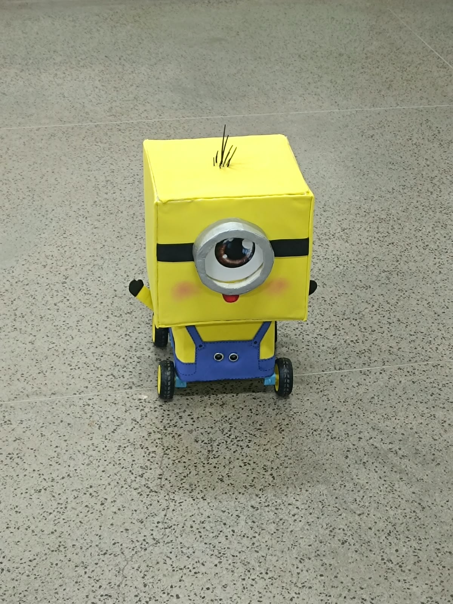

# MinionRobo

<p align="center">
  
</p>

<p align="center">
  Robô autônomo inspirado nos Minions, desenvolvido com ESP32-S3 para acompanhar objetos e pessoas com segurança.
</p>

## Sobre o projeto

Tivemos a oportunidade de desenvolver um robô inspirado nos Minions, projeto que levamos ao evento **TechnoFast, da [Fatec Itu](https://www.linkedin.com/school/fatec-itu/)**.

Utilizando um **ESP32-S3**, sensores e dois motores, construímos um sistema capaz de acompanhar objetos e pessoas com base na proximidade. Durante o movimento, o robô faz leituras periódicas do **HC-SR04** frontal para verificar a distância e decidir se deve continuar seguindo, procurar o alvo ou interromper o deslocamento.

O projeto também possui uma camada de segurança: ao detectar uma aproximação muito grande, o robô reduz ou interrompe o movimento para evitar colisões. O sensor infravermelho instalado na parte traseira funciona como uma proteção adicional contra aproximações rápidas.

Foi muito legal fazer parte desse projeto, aprender coisas novas durante o desenvolvimento e ver o robô funcionando de verdade. Adoramos acompanhar cada etapa e ver a ideia tomando forma!

## Como funciona

O firmware é organizado em módulos e executa o seguinte ciclo:

1. Inicializa os sensores, motores, diagnóstico e monitor Wi-Fi.
2. Faz a leitura filtrada do sensor ultrassônico frontal.
3. Usa uma máquina de estados para buscar o alvo, realizar varreduras laterais e acompanhá-lo.
4. Controla os dois lados do robô por meio de um **L298N** e PWM.
5. Para ou executa uma manobra de recuperação quando identifica risco de colisão ou perde o alvo.
6. Disponibiliza o estado do robô em uma API HTTP somente leitura.

Os principais estados de autonomia são:

- Inicialização segura
- Busca pelo alvo
- Varredura para a esquerda, centro e direita
- Acompanhamento do alvo
- Fuga para frente
- Giro de recuperação
- Parada segura

Os limites de distância ficam centralizados em [`main/Config.h`](main/Config.h) e podem ser ajustados conforme o peso do robô, o piso, a bateria e a calibração dos motores. Na configuração atual, o robô não avança abaixo de **28 cm** e entra em situação de emergência abaixo de **15 cm**.

## Hardware

- ESP32-S3 DevKitC-1
- Ponte H L298N
- Dois motores DC com rodas
- Sensor ultrassônico HC-SR04 na parte frontal
- Sensor infravermelho na parte traseira
- Bateria e estrutura inspirada nos Minions

O mapa de GPIOs está disponível em [`main/Pins.h`](main/Pins.h). O pino `ECHO` do HC-SR04 deve chegar ao ESP32-S3 com, no máximo, **3,3 V**.

## Monitor Wi-Fi

O ESP32 cria um ponto de acesso próprio:

| Item | Valor |
| --- | --- |
| Rede | `MinionRobo` |
| Senha | `minion123` |
| Endereço padrão | `http://192.168.4.1` |

Para usar o monitor:

1. Grave o firmware da pasta [`main/`](main/) no ESP32-S3.
2. Conecte o computador à rede Wi-Fi `MinionRobo`.
3. Abra [`monitor/index.html`](monitor/index.html) no navegador.
4. Informe o endereço do ESP32 no campo **ESP** e clique em **Conectar**.

O monitor consulta apenas os endpoints `GET /api/status` e `GET /api/health`. Ele não envia comandos de movimento: o controle dos motores permanece sob responsabilidade do firmware autônomo. Caso o endereço do ponto de acesso mude, use o IP exibido no Monitor Serial.

## Organização do repositório

```text
.
├── imgs/
│   └── minion.jpeg              # Foto do robô
├── main/                        # Firmware principal do ESP32-S3
│   ├── main.ino
│   ├── AutonomyController.*
│   ├── MotorController.*
│   ├── UltrasonicSensor.*
│   ├── IrSensor.*
│   ├── WifiMonitor.*
│   ├── Diagnostics.*
│   ├── Config.h
│   ├── Pins.h
│   └── RobotTypes.h
├── monitor/                     # Painel web de monitoramento
├── teste_motores/               # Testes dos motores
├── teste_sensores_web/          # Testes dos sensores via web
└── teste_ultrassonico_serial/  # Testes do ultrassônico via Serial
```

## Próximos passos

**E ainda não acabou!**

Nossa ideia é evoluir o robô com a implementação de sensores infravermelhos laterais. Assim, será possível identificar melhor a direção do alvo, aprimorar o acompanhamento de pessoas e manter uma distância segura com mais precisão.

## Equipe

- [Guilherme Corrêa Narcizo](https://github.com/GuilhermeCN-web)
- [Felipe Soares Paterni Chaves](https://github.com/felipePaterni)
- [Isabela Moreno](https://github.com/isabmoreeno)
- [Mariana Floriano De Sant'anna](https://github.com/marianafloriano1)
- [Rafaela](https://github.com/RafaApS)

Desenvolver esse projeto em equipe foi uma experiência muito especial. Obrigado, Guilherme, Felipe, Isabela, Mariana e Rafaela, por todo o trabalho e pela parceria!
